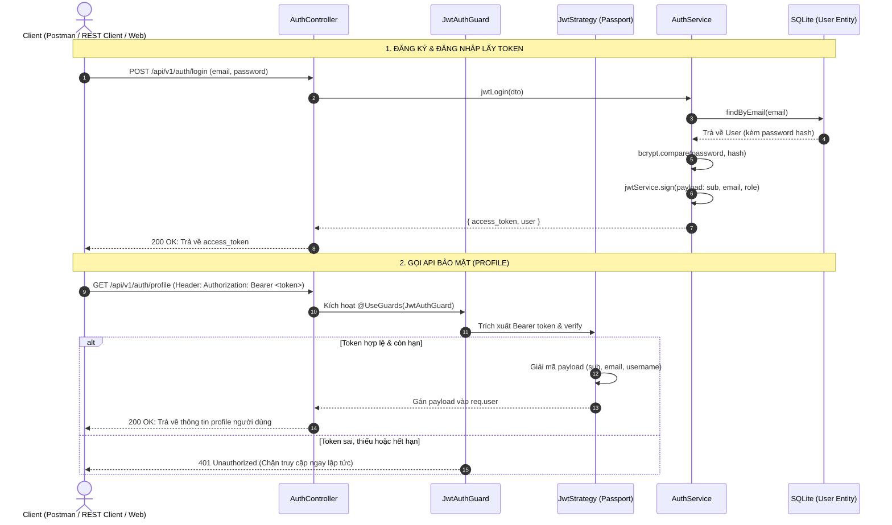

<p align="center">
  <a href="http://nestjs.com/" target="blank"></a>
</p>

# Oniverse Backend - NestJS JWT Authentication Service

Ứng dụng backend xây dựng bằng framework **NestJS**, hiện thực hóa hệ thống xác thực người dùng chuẩn **Passport-JWT Authentication** theo tài liệu chính thức của NestJS ([docs.nestjs.com/security/authentication](https://docs.nestjs.com/security/authentication#jwt-functionality)), tích hợp lưu trữ SQLite với TypeORM và mã hóa mật khẩu bảo mật một chiều bằng **bcrypt**.

---

## 1. Sơ đồ quy trình hoạt động (Sequence Diagram)



---

## 2. Chi tiết các bước thực thi kỹ thuật

### 2.1. Đăng ký tài khoản (`POST /api/v1/auth/register`)
- **Dữ liệu gửi lên (Body):** `{ email, password, username }`.
- **Luồng xử lý:**
  1. DTO `RegisterDto` kiểm tra tính hợp lệ của dữ liệu đầu vào.
  2. `AuthService.register()` sử dụng thư viện **bcrypt** băm mật khẩu với `saltRounds = 10` thành chuỗi hash an toàn dạng `$2b$10$...` (tuyệt đối không lưu mật khẩu bản rõ vào database).
  3. Lưu thông tin người dùng vào cơ sở dữ liệu SQLite thông qua `UserService.registerWithPassword()`.
  4. Khởi tạo `access_token` bằng `jwtService.sign(payload)` với payload chứa `{ sub: user.id, email, username, role }`.
- **Kết quả trả về:** HTTP 201 Created kèm thông tin người dùng và chuỗi `access_token`.

### 2.2. Đăng nhập (`POST /api/v1/auth/login`)
- **Dữ liệu gửi lên (Body):** `{ email, password }`.
- **Luồng xử lý:**
  1. `AuthService.jwtLogin()` gọi `validateUser(email, password)`.
  2. Truy vấn người dùng trong database bằng email qua `UserService.findByEmail()`.
  3. Sử dụng `bcrypt.compare(password, user.password)` để so khớp mật khẩu người dùng nhập với chuỗi băm trong DB.
  4. Nếu không khớp: Ném lỗi `401 Unauthorized ('Email hoặc mật khẩu không chính xác.')`.
  5. Nếu khớp: Đóng gói payload `{ sub: user.id, email: user.email, username: user.username, role: user.role }`.
  6. Ký và tạo chuỗi JWT bằng secret key (`jwtConstants.secret`) với thời hạn hiệu lực 1 ngày (`expiresIn: '1d'`).
- **Kết quả trả về:** HTTP 200 OK kèm `access_token` và thông tin `user`.

### 2.3. Gọi tài nguyên bảo mật (`GET /api/v1/auth/profile`)
- **Dữ liệu gửi lên:** Header `Authorization: Bearer <access_token>`.
- **Luồng xử lý:**
  1. Request gửi đến endpoint `/auth/profile`, gặp decorator `@UseGuards(JwtAuthGuard)`.
  2. `JwtAuthGuard` (kế thừa `AuthGuard('jwt')` của Passport) bắt request và kích hoạt `JwtStrategy`.
  3. `JwtStrategy` tự động trích xuất chuỗi Bearer token từ Header và giải mã bằng `jwtConstants.secret`:
     - Nếu token không tồn tại, bị làm giả hoặc đã hết hạn: Passport chặn lại ngay lập tức và phản hồi mã lỗi `401 Unauthorized`.
     - Nếu token hợp lệ: Hàm `validate(payload)` trích xuất thông tin `{ userId: payload.sub, email: payload.email, username: payload.username, role: payload.role }` và tự động gắn vào đối tượng `req.user`.
  4. Controller nhận request hợp lệ, lấy dữ liệu từ `req.user` và trả về profile người dùng.

---

## 3. Danh mục mã nguồn và vai trò các file

| Thành phần | Đường dẫn file | Vai trò & Nhiệm vụ |
| :--- | :--- | :--- |
| **Cấu hình Secret** | `src/auth/constants.ts` | Lưu `jwtConstants.secret` dùng làm khóa bí mật để ký và giải mã JWT token. |
| **Module Auth** | `src/auth/auth.module.ts` | Khai báo `PassportModule`, cấu hình `JwtModule.register()` với secret và thời hạn token. |
| **DTOs Xác thực** | `src/auth/dto/register.dto.ts`<br>`src/auth/dto/jwt-login.dto.ts` | Định nghĩa schema và kiểm tra dữ liệu đầu vào khi Client đăng ký, đăng nhập. |
| **Entity Database** | `src/user/entities/user.entity.ts` | Bảng `users` trong SQLite (lưu trường `password` hash bcrypt, `email`, `role`,...). |
| **User Service** | `src/user/user.service.ts` | Xử lý nghiệp vụ người dùng: `registerWithPassword` (lưu user mới), `findByEmail` (tìm theo email). |
| **Auth Service** | `src/auth/auth.service.ts` | Băm mật khẩu bcrypt, kiểm tra đăng nhập (`validateUser`), ký JWT token (`jwtLogin`, `register`). |
| **Passport Strategy** | `src/auth/strategies/jwt.strategy.ts` | Kế thừa `PassportStrategy(Strategy)`, tự động bóc tách Bearer token từ Header và giải mã payload vào `req.user`. |
| **Auth Guard** | `src/auth/guards/jwt-auth.guard.ts` | Decorator `@UseGuards(JwtAuthGuard)` làm chốt chặn bảo vệ các endpoint yêu cầu xác thực. |
| **Auth Controller** | `src/auth/auth.controller.ts` | Cung cấp các endpoint: `POST /auth/register`, `POST /auth/login`, `GET /auth/profile`. |
| **Kiểm thử tự động** | `test/app.e2e-spec.ts` | Bộ test tự động toàn diện e2e (3/3 passed) kiểm tra luồng Register -> Login -> Profile. |
| **Kiểm thử nhanh** | `test.http` | File kịch bản test bằng extension REST Client trong VS Code. |

---

## 4. Hướng dẫn cài đặt và Chạy thử nghiệm

### 4.1. Cài đặt thư viện phụ thuộc
```bash
$ npm install
```

### 4.2. Khởi chạy máy chủ phát triển
```bash
$ npm run start:dev
```
Server backend sẽ lắng nghe tại cổng `http://localhost:4000/api/v1`.

### 4.3. Chạy kiểm thử tự động (E2E Test)
```bash
$ npm run test:e2e
```

### 4.4. Kiểm thử trực tiếp bằng REST Client
Mở file `test.http` trong VS Code (đã cài extension REST Client) và bấm **Send Request** trên từng request:
1. `POST /auth/register`: Đăng ký tài khoản mới.
2. `POST /auth/login`: Đăng nhập lấy Bearer token.
3. `GET /auth/profile`: Gửi kèm `Authorization: Bearer <token>` để kiểm tra truy cập thành công.
4. `GET /auth/profile` (không token): Kiểm tra Guard chặn `401 Unauthorized`.
